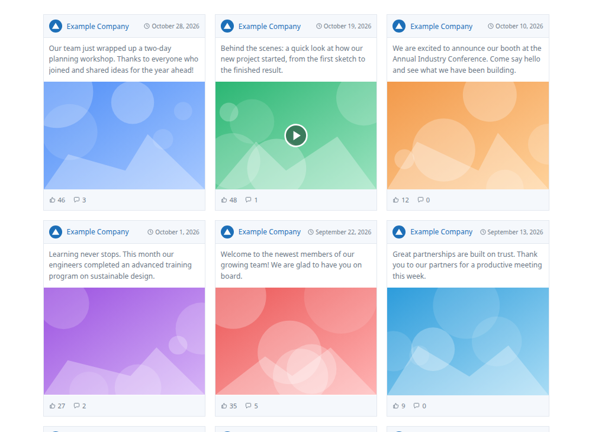

# LinkedIn Page Feed

A WordPress plugin that shows the latest posts from a LinkedIn Company Page as a card grid, using the official LinkedIn REST API.



## Features

- `[linkedin_feed]` shortcode — works in the block editor, Classic editor, Elementor and any page builder with a Shortcode widget
- Card layout: Page logo and name, date, post text (3 lines), image or video thumbnail with play button, like and comment counts
- Whole card links to the post on LinkedIn
- Responsive grid: 1–6 columns, collapses to 2 / 1 on smaller screens
- One-click OAuth connection from the WordPress admin, with automatic token refresh
- Images, video thumbnails and the logo are stored once in `wp-content/uploads/` — LinkedIn's image URLs expire and its image API has a low daily limit
- Cached feed (default 60 min); if LinkedIn is unreachable the last good posts are shown and retried after 5 minutes
- Errors are only visible to administrators; visitors never see a broken feed
- No external libraries

## Requirements

- WordPress 6.0+
- PHP 7.4+
- Site served over HTTPS (LinkedIn only allows `http` redirect URLs for localhost)
- A LinkedIn developer app with the **Community Management API** product, granting the scopes
  `r_organization_social` and `rw_organization_admin`
- A LinkedIn account that is an admin of the Page you want to show

## Installation

1. Download this repository as a ZIP (or build one containing the `linkedin-page-feed` folder).
2. In WordPress go to **Plugins → Add New → Upload Plugin**, upload the ZIP and activate it.

## Setup

### 1. LinkedIn app

In the [LinkedIn Developer Portal](https://www.linkedin.com/developers/apps), open your app's **Auth** tab:

1. Under **Authorized redirect URLs**, add the URL shown on the plugin's settings page. It looks like:
   ```
   https://your-site.com/wp-admin/admin-post.php?action=lpf_oauth_callback
   ```
   It must match exactly (protocol, `www`, subfolder).
2. Copy the **Client ID** and **Primary Client Secret**.

### 2. WordPress

Go to **Settings → LinkedIn Feed**:

| Setting | Description |
|---|---|
| Client ID | From the LinkedIn app's Auth tab |
| Client secret | From the LinkedIn app's Auth tab. Leave blank when saving to keep the stored one |
| Default Page ID | The numeric Page (organization) ID used when the shortcode has no `org` |
| Logo URL | Optional. Overrides the Page logo shown on the cards |
| API version | LinkedIn API version, `YYYYMM` (default `202609`) |
| Cache (minutes) | How long fetched posts are reused (minimum 5) |

Save, then click **Connect LinkedIn** and approve access. After connecting, the settings page lists every Page your account administers, with its ID and a ready-made shortcode.

To keep the secret out of the database, define it in `wp-config.php` instead:

```php
define( 'LPF_CLIENT_SECRET', 'your-client-secret' );
```

### Finding a Page ID

- Open the Page on LinkedIn as an admin — the URL is `linkedin.com/company/<ID>/admin/`
- Or connect the plugin and read it from the **Your Pages** table

## Usage

```
[linkedin_feed]
[linkedin_feed org="1234567" count="12" cols="4"]
```

| Attribute | Default | Description |
|---|---|---|
| `org` | Default Page ID | LinkedIn Page (organization) ID |
| `count` | `24` | Number of posts, 1–100 |
| `cols` | `3` | Grid columns, 1–6 |

**Elementor:** drag a **Shortcode** widget onto the page and paste the shortcode.

## Styling

The feed uses CSS custom properties that you can override in your theme or in **Appearance → Customize → Additional CSS**:

```css
.lpf-grid {
  --lpf-accent: #1d6fb8;  /* Page name, links */
  --lpf-muted:  #6b7785;  /* text, date, counts */
  --lpf-bar:    #f5f8fc;  /* header and footer background */
  --lpf-border: #e3e8ef;  /* card border */
}
```

The font is inherited from your theme. Main class names: `.lpf-card`, `.lpf-head`, `.lpf-text`, `.lpf-media`, `.lpf-foot`.

## How it works

| Data | LinkedIn endpoint |
|---|---|
| Posts | `GET /rest/posts?q=author` |
| Images | `GET /rest/images?ids=List(...)` (batch) |
| Video thumbnails | `GET /rest/videos?ids=List(...)` (batch) |
| Like / comment counts | `GET /rest/organizationalEntityShareStatistics` |
| Page name and logo | `GET /rest/organizations/{id}` (cached for a week) |

Each media item is downloaded only once. After that, a cache refresh makes just two API calls (posts and statistics).

Stored data:

- Options: `lpf_settings`, `lpf_token`, `lpf_feed_cache`, `lpf_orgs`, `lpf_media`
- Files: `wp-content/uploads/linkedin-page-feed/`

The access token (60 days) is refreshed automatically while the refresh token is valid (about one year). After that, click **Reconnect** in the settings.

## Limitations

- Document (PDF/carousel) posts and polls are shown as text only
- Only the first image of multi-image posts is shown
- The like count is LinkedIn's `likeCount` statistic
- Text is shown as plain text; hashtags and mentions are kept as words, not links
- The first load after connecting downloads all images and may take a few seconds

## Uninstall

Deleting the plugin from **Plugins** removes all its options and the stored images. Deactivating keeps them.

## License

GPL-2.0-or-later
